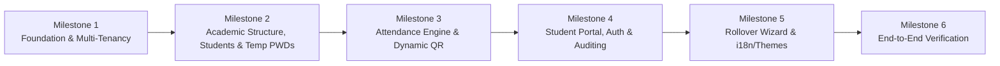

# MVP Scope & Delivery Milestones

| Document Version | 1.0.0 |
| :--- | :--- |
| **Status** | Approved Scope Definition |
| **Release Target** | Phase 1 Minimum Viable Product (Commercial SaaS) |

---

## 1. Scope Boundaries: In-Scope vs. Deferred (Phase 2)

```
┌────────────────────────────────────────┐  ┌────────────────────────────────────────┐
│             IN-SCOPE (MVP)             │  │          DEFERRED (PHASE 2+)           │
├────────────────────────────────────────┤  ├────────────────────────────────────────┤
│ • PlatformAdmin Provisioning Portal    │  │ • Automated Payment / Stripe / Fawry   │
│ • Teacher Auth (Username/Password)     │  │ • Automated Parent SMS / WhatsApp Notifs│
│ • Student Auth (Student Code + Password│  │ • Complex Email/SMS/OTP Recovery Flows │
│ • Teacher-Driven Simple Password Reset │  │ • Student Self-Registration (Strictly  │
│ • Subjects & Groups Management         │  │   Disallowed)                          │
│ • On-Demand Session Creation           │  │ • Homework & Exam Grade Tracking       │
│ • Dual Attendance (Manual & Dynamic QR)│  │ • Assistant / Co-Teacher Delegated RBAC│
│ • Statuses (Present, Absent, Late, Exc)│  │ • Offline Sync with IndexedDB Queue    │
│ • Post-Session Audited Editing         │  │ • Geofencing / Wi-Fi SSID Verification  │
│ • Academic Year Rollover Workflow      │  │ • Native App Store Wrappers (Capacitor│
│ • Arabic (RTL) & English (LTR) i18n    │  │ • AI Attendance Predictive Analytics   │
│ • Warm Gold / Navy Blue Dual Theme     │  │ • Face Recognition Check-in            │
│ • Export Roster to CSV/Excel           │  │ • Multi-Branch School Management       │
└────────────────────────────────────────┘  └────────────────────────────────────────┘
```

---

## 2. Detailed In-Scope Feature Breakdown

### Phase 1: MVP Core Features

#### 1. Identity & Tenant Management
- **PlatformAdmin Portal**: Simple, secure interface to create teachers (FullName, Username, TempPassword, Phone, BrandName).
- **Teacher Account Lifecycle**: Activation, deactivation, password change.
- **Tenant Context Isolation**: Automatic request filtering by `TeacherId`.

#### 2. Academic Structure, Rostering & Student Provisioning
- **Academic Years**: Set active year, create new years, view historical archives.
- **Subjects**: Create and manage subjects (e.g., "Arabic - 1st Secondary").
- **Groups**: Create groups tied to a subject and academic year (name, time slot description, capacity).
- **Students**: Create student records (Name, Phone, Parent Phone, Student Code, Grade).
- **Student Provisioning**: System auto-generates unique Student Code and simple, human-readable temporary password (e.g., `Falcon482`) via CSPRNG from neutral words.
- **Teacher Password Reset**: One-click password reset on student profile generating a readable temporary password (letters + numbers, no symbols, no ambiguous chars).
- **Group Transfer**: Move student between groups while preserving past group attendance.

#### 3. Dynamic Attendance Engine
- **Session Creator**: Launch on-demand sessions selecting target group(s) and topic.
- **Manual Attendance Grid**: High-density, fast-tap roster with status toggles (Present, Absent, Late, Excused).
- **Dynamic QR Code Display**: Teacher-projected rotating QR code (20s TTL) with live counter of checked-in students.
- **In-App QR Scanner**: Student scans rotating QR code to mark attendance.
- **Audit Logging**: Any post-session change recorded with teacher ID, old/new status, timestamp, and reason.

#### 4. Student Portal Experience
- **Authentication**: Login via `StudentCode` + `Password`.
- **First-Login Enforcement**: Forced password change screen upon login with temporary password.
- **Voluntary Password Update**: Student self-service password update in settings.
- **Attendance Timeline**: Inspection of historical attended sessions and percentage stats.

#### 5. Academic Year Rollover Wizard
- Step-by-step workflow:
  1. Define new Academic Year (e.g., `2027/2028`).
  2. Review student roster: bulk select **Promote** (advance grade), **Repeat** (keep grade), or **Depart** (archive).
  3. Confirm rollover: past year marked archived, past sessions preserved 100%, new cohorts formed.

#### 6. Bilingual UI & Theme Engine
- Native Arabic (RTL) and English (LTR) with instant toggle.
- Light Theme (Warm gold accents + neutral ivory) and Dark Theme (Light blue accents + dark navy).

---

## 3. User Story Acceptance Criteria

### US-01: Teacher Provisioning
- **Given** an authenticated PlatformAdmin,
- **When** submitting the "Create Teacher" form with unique username,
- **Then** a new teacher record is created in the database, with a securely hashed password and an active status.

### US-02: Fluid Session & QR Attendance
- **Given** an active teacher with an enrolled group of 25 students,
- **When** the teacher clicks "Start Session" and displays the QR code,
- **Then** a 20-second rotating cryptographic QR code renders on screen.
- **When** an authenticated student (logged in with `StudentCode` + `Password`) scans the QR code within the 20-second window,
- **Then** their attendance is marked as `Present`, the teacher’s check-in counter increments immediately, and a second scan attempt by the same student returns `ALREADY_CHECKED_IN`.

### US-03: Audited Attendance Override
- **Given** a session marked as `Closed` with student John recorded as `Absent`,
- **When** the teacher manually edits John's status to `Excused` and provides the reason "Medical certificate submitted",
- **Then** John's attendance status updates in `AttendanceRecords`, and an immutable entry is added to `AttendanceAuditLogs`.

### US-04: Academic Year Transition Without Data Loss
- **Given** Academic Year `2025/2026` containing 50 sessions and 1,200 attendance records,
- **When** the teacher executes the Rollover Wizard to launch `2026/2027` and promotes Grade 10 students to Grade 11,
- **Then** Year `2025/2026` is archived, Year `2026/2027` is active, all 50 sessions and 1,200 attendance records remain intact and readable, and promoted students appear in their new grade level.

### US-05: Simple Teacher-Driven Student Password Reset
- **Given** an authenticated teacher viewing the profile of student Sarah who forgot her password,
- **When** the teacher clicks "Reset Password",
- **Then** the system outputs a simple, readable alphanumeric password (e.g., `Falcon482`), immediately hashes it into `Student.PasswordHash`, increments Sarah's `TokenVersion` (invalidating existing active JWT sessions), sets `MustChangePassword = true`, and logs the event in `PasswordResetAuditLogs`.
- **When** Sarah logs in with `Falcon482`,
- **Then** she is locked into the "Create New Password" screen until she successfully defines a new password.

---

## 4. Phase-Gate Implementation Sequence



1. **Milestone 1: Solution Scaffold & Tenant Engine**:
   - .NET 10 solution setup, EF Core DbContext, global query filters, JWT auth for PlatformAdmin and Teachers.
2. **Milestone 2: Academic Domain, Student Rostering & Password Generator**:
   - CRUD for Academic Years, Subjects, Groups, and Students.
   - Student Code generator and readable CSPRNG temporary password generator (letters + numbers only).
   - Teacher-driven student password reset endpoint and audit trail.
3. **Milestone 3: Attendance Engine & Dynamic QR**:
   - Session lifecycle, manual checklist, dynamic HMAC token generator, student QR scanner handshake.
4. **Milestone 4: Student Portal, Authentication & Auditing**:
   - Student login endpoint (`StudentCode` + `Password`), mandatory password change screen, voluntary password change, student attendance timeline view.
5. **Milestone 5: Academic Rollover, Localization & Theme System**:
   - Rollover wizard, Arabic/English RTL/LTR engine, warm gold and dark navy Tailwind design system.
6. **Milestone 6: Hardening & Commercial Covenant Verification**:
   - Security verification (rate-limiting, cross-tenant isolation tests, stress test on QR check-ins, password security verification).
   - **Verification against Commercial Service Covenant (`docs/PRODUCT_REQUIREMENTS.md#7`)**: Automated end-to-end validation ensuring 100% of commercial promises made to clients (20s QR rotation, 5s password reset, TokenVersion invalidation, 48px fast-tap grid, zero-email student code login, and multi-tenant isolation) pass verification without compromise.
