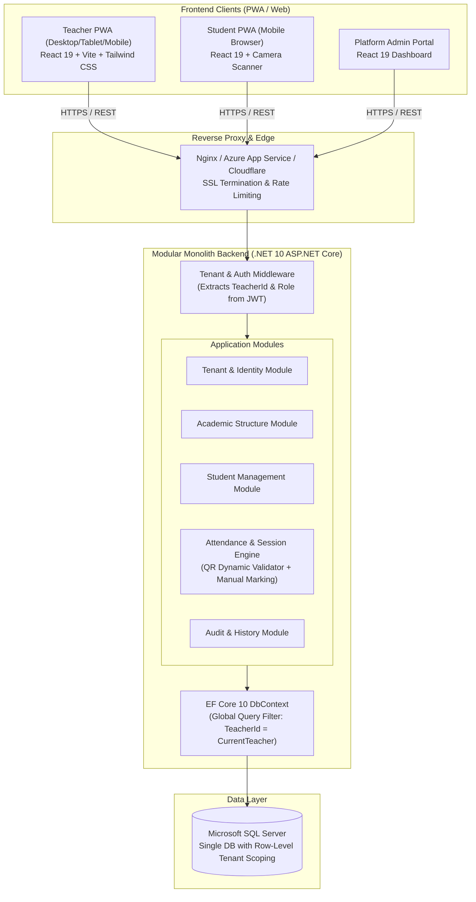
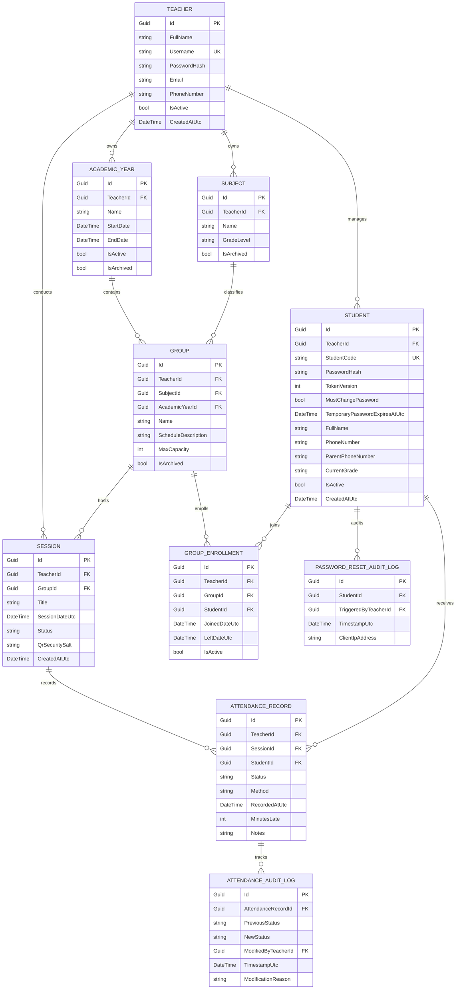
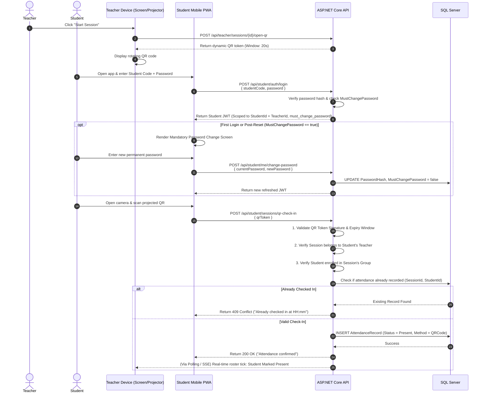
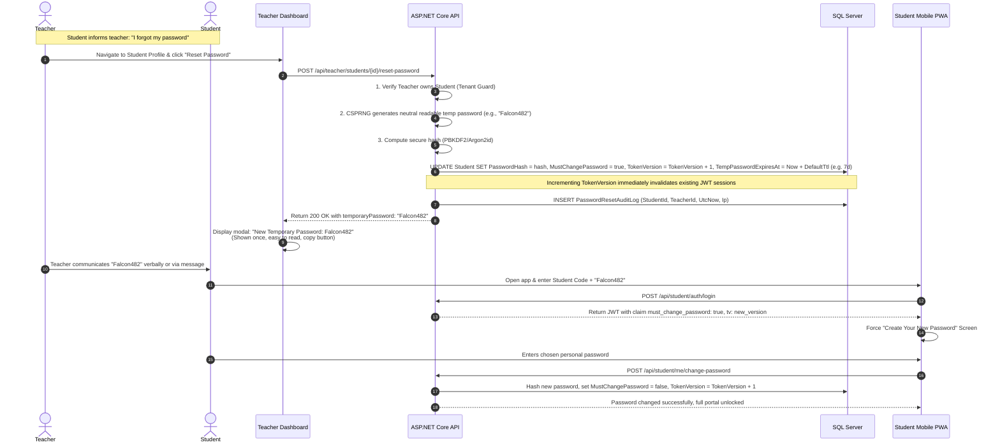

# Proposed System Architecture

| Document Version | 1.0.0 |
| :--- | :--- |
| **Status** | Architectural Blueprint |
| **Pattern** | Modular Monolith + Shared Database Multi-Tenancy |

---

## 1. System Topology Overview



---

## 2. Monolith vs. Microservices Justification

### Selected Pattern: **Modular Monolith**
For Hudoor’s scale, team structure, and domain requirements, a Modular Monolith offers significant operational and technical advantages over microservices:
1. **Low Operational Overhead**: Single deployment unit, single database connection pool, and no complex distributed tracing or service mesh infrastructure.
2. **Strict Transactional Guarantees**: Complex operations like **Academic Year Rollover** and **Audit Log generation** can occur within native ACID transactions without distributed 2PC (Two-Phase Commit) or eventual consistency anomalies.
3. **Internal Module Encapsulation**: Modules communicate via typed interfaces and in-process mediator commands/queries. If a specific module (e.g., Attendance QR processing) needs to scale independently in the future, boundaries are cleanly drawn for easy extraction.

---

## 3. Multi-Tenancy Architecture

### 3.1 Tenancy Strategy: Shared Database, Shared Schema
- All tenants share the same SQL Server database.
- Every tenant-scoped entity implements `ITenantEntity`:
  ```csharp
  public interface ITenantEntity
  {
      Guid TeacherId { get; set; }
  }
  ```
- Cross-tenant leakage is prevented at three defensive layers:
  1. **JWT Claim Extraction**: `TeacherId` is resolved exclusively from the cryptographically verified JWT bearer token by `TenantContextMiddleware`.
  2. **EF Core Global Query Filters**:
     ```csharp
     modelBuilder.Entity<Group>()
         .HasQueryFilter(e => e.TeacherId == _tenantContext.TeacherId);
     ```
  3. **Repository / Command Handler Invariant Checks**: Every create/update mutation explicitly validates that modified child entities belong to `_tenantContext.TeacherId`.
  4. **Database Clustered/Non-Clustered Indexes**: All foreign keys and high-frequency queries lead with `(TeacherId, ...)`.

---

## 4. Entity-Relationship Model (Schema Blueprint)



---

## 5. Dynamic QR Attendance Handshake Sequence



---

## 6. Teacher-Driven Student Password Reset Sequence



---

## 7. Practical JWT Session Revocation Strategy for Modular Monolith

A critical architectural consideration in token-based architectures is session revocation. Pure stateless JWTs cannot be revoked mid-flight by default without an active state validation mechanism.

### 7.1 Architecture Trade-Off Evaluation

| Approach | How It Works | Pros | Cons | Verdict |
| :--- | :--- | :--- | :--- | :---: |
| **1. Pure Stateless Tokens (Short TTL)** | Rely strictly on token expiration (e.g., 15 minutes) + Refresh Tokens in DB. | Fully decoupled; zero DB lookup on normal API calls. | Compromised student device remains valid for up to 15 minutes after password reset. | Rejected (violates immediate invalidation requirement) |
| **2. Distributed Token Blacklist (Redis)** | Write revoked JWT `jti` (Token ID) to Redis cache with TTL matching token expiration. | Immediate invalidation; fast key lookup. | Adds external Redis dependency, infrastructure cost, connection clustering, and operational complexity. | Over-engineered for MVP Monolith |
| **3. Database TokenVersion / Security Stamp Validation (Recommended)** | Add an integer `TokenVersion` column to the `Student` entity, embedded as claim `tv` in the JWT. On each authenticated student API request, authorization handler compares `claim.tv == student.TokenVersion` directly against the database entity via fast indexed lookup. Password updates and `TokenVersion++` execute atomically in the same database transaction. | • Instantaneous revocation: previous tokens become invalid on their immediate next request.<br/>• Eliminates stale-cache authorization vulnerabilities.<br/>• Zero external infrastructure dependencies (no Redis required for MVP).<br/>• Fits Clean Architecture Modular Monolith seamlessly. | Requires a lightweight indexed DB check per student authenticated request. | **Recommended for MVP Architecture** |

---

## 8. Frontend Architectural Blueprint

### 8.1 Technology Choice & Rationale
- **Vite + React 19 + TypeScript**: Maximum developer ergonomics, ultra-fast builds, and strict type safety across all DTO contracts.
- **Tailwind CSS v4**: Utility-first styling with native CSS variables supporting zero-runtime theme switches (Light Warm Gold vs. Dark Navy Blue) and RTL flip utilities (`ms-`, `me-`, `start-`, `end-`).
- **PWA Capabilities**: Service Worker caching of static assets and shell UI using Workbox; offline roster viewing for teachers in erratic network zones.
- **State Management**:
  - **Server State**: `@tanstack/react-query` for smart caching, background refetching, and optimistic roster updates.
  - **Client State**: Lightweight `Zustand` store for Auth tokens, Active Theme, and Language preference.

### 8.2 Internationalization (i18n) Engine
- Built with `i18next` and `react-i18next`.
- Supports dynamic `document.documentElement.setAttribute('dir', 'rtl' | 'ltr')`.
- All custom user data (Student Names, Subject Titles, Notes) bypass the translation layer and render strictly in their raw input character set.
- All custom user data (Student Names, Subject Titles, Notes) bypass the translation layer and render strictly in their raw input character set.
